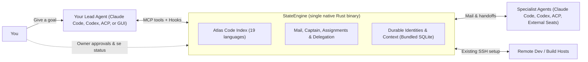

<div align="center">

# StateEngine

**Give your coding agent a goal. It can map the code, coordinate other agents, and run work on another machine.**

*The local control plane for coding agents — one native Rust binary.*

[](https://github.com/StateEngine/StateEngine/releases)
[](LICENSE-MIT)
[](docs/INSTALL.md#supported-platforms)
[](Cargo.toml)

[Quickstart](#quickstart) · [Works With Your Setup](#works-with-your-existing-setup) · [Capabilities](#what-your-agent-can-do) · [Remote Machines](#work-across-machines-over-ssh) · [Documentation](#documentation)

</div>

---

Coding agents shine in a single chat—until you need them to understand a large diff, bring in a second model to review it, hand off work without losing context, or run a heavy test suite on another machine.

With StateEngine wired into your project, you don't micromanage scripts or switch editors. You give your lead agent a goal:

> *Use Atlas to check what this diff impacts. Ask the Claude Code reviewer to audit the auth changes, delegate the test run to the build box over SSH, and bring me back what passed and what needs my decision.*

Your agent uses StateEngine directly over **MCP**. You keep the tools you already use—**Claude Code**, **Codex**, virtually **any ACP agent**, or your favorite **editor or desktop GUI**—and let your agents coordinate the fleet while you keep Owner control over approvals, permissions, and credentials.



> [!NOTE]
> **Early alpha (`v0.1.2`).** StateEngine is pre-1.0: commands and saved state can change between releases. Start on a backed-up repo and [report issues on GitHub](https://github.com/StateEngine/StateEngine/issues).

---

## Works with your existing setup

You don't have to abandon your editor, terminal, or favorite coding assistant. StateEngine is a tool you hand to the agents you already run:

| How you work | What StateEngine supports | How it connects |
| --- | --- | --- |
| **Claude Code & Codex** | First-class built-in support: auto-wired MCP, pre-edit Atlas hooks, exact session resume, per-agent model/endpoint overrides, and session adoption (`se init --adopt` on Linux & Windows) | `se init --provider claude\|codex` |
| **Universal ACP agents** | Works with virtually any agent that speaks Agent Client Protocol v1—auto-detects **Antigravity**, **Cursor**, **Grok**, **OpenCode**, **Gemini**, **DeepSeek**, **Oh My Pi**, **Qwen Code**, **Goose**, **Hermes**, **Kimi**, **Auggie**, and **Cline**, plus any custom ACP agent via `se harness add` | `se init --harness <name>` |
| **Desktop GUIs & Editors (External Seats)** | Keep using desktop apps, chat GUIs, or MCP-enabled editors as named agents on your project team—Owner-approved out of band, with identity, agent mail, and working notes | `se agent add <name> --external` + `se mcp --as <name>` |
| **Any MCP client** | Connect any read-only MCP tool to inspect project status, Atlas code navigation, captain state, and recorded history | `se mcp` |

See [docs/HARNESSES.md](docs/HARNESSES.md) for permission profiles, per-agent model routing, and custom ACP harness descriptors.

---

## Quickstart

### 1. Install

StateEngine ships as one native `se` executable with bundled SQLite and no external runtime dependencies. You only need [Git](https://git-scm.com/downloads) and at least one signed-in provider ([Claude Code](https://code.claude.com/docs/en/setup) or [Codex CLI](https://developers.openai.com/codex/cli/) `0.152.0+`). StateEngine uses your own provider account.

**Linux & macOS**
```sh
curl --proto '=https' --proto-redir '=https' -fsSL https://github.com/StateEngine/StateEngine/releases/latest/download/install.sh | sh
```

**Windows (PowerShell)**
```powershell
irm https://github.com/StateEngine/StateEngine/releases/latest/download/install.ps1 | iex
```

**npm** (Node.js 18+, installs the matching native binary with `--ignore-scripts` support)
```sh
npm install -g @stateengine/cli
```

Verify from a fresh terminal (or run the absolute path printed by the installer):

```sh
se --version
```

<details>
<summary>Platform support, checksums, and uninstall</summary>

- **Supported platforms:** Linux x86_64 (glibc), macOS (Apple Silicon & Intel), Windows x86_64.
- **Security:** Runs as your normal user (no admin/sudo). Releases are currently unsigned; installers verify SHA-256 checksums before extracting.
- **Upgrade / Uninstall:** Re-run the installer (or `npm update -g @stateengine/cli`). Remove cleanly with `se uninstall` (or `npm uninstall -g @stateengine/cli`) — your repositories, saved history, and provider logins remain intact.
- See [docs/INSTALL.md](docs/INSTALL.md) for pinned versions, manual checksum verification, `--no-modify-path`, and building from source.

</details>

### 2. Initialize your repo and launch your first agent

`se init` registers your repository, saves an agent named `main`, and wires StateEngine's MCP server into your provider. It writes **nothing** into your working tree and leaves Git history untouched.

```sh
cd /path/to/your/repo
se init --provider claude      # or: se init --provider codex (or --harness <acp-name>)
se launch main                 # opens interactively on desktop
```

<details>
<summary>Running headless or over SSH?</summary>

Pass `--task` and `--detach` to run without a desktop window, then follow progress from any shell:

```sh
se launch main --task "Inspect the repo and summarize its architecture." --detach
se status                      # runtime, agents, live context-window fill, unread mail
se history --agent main        # read saved turns as they commit
```

</details>

### 3. Hand your agent its first prompt

Paste this into your launched agent:

> *Use StateEngine's Atlas tools to inspect an important function in this repo. Show me where it's defined, who calls it, what tests cover it, and cite the file and line references. Then save a short StateEngine working note with one follow-up question.*

Atlas builds its local index automatically in the background. When you come back later, reopen the same provider conversation (`se launch main --resume`) or start a fresh session and ask your agent to read its saved working state and pick up that question.

---

## What your agent can do

Managed Claude Code, Codex, and ACP sessions get StateEngine's MCP tool catalogue (up to **31 MCP tools** across **67 registered operations**, scoped by each session's grants). Owner-approved external seats receive a focused, least-privilege subset covering identity (`whoami`), project mail (`list`, `read`, `ack`, `dismiss`, `send`), and working notes (`working_state`).

### Map the codebase before editing (Atlas)

Instead of burning context tokens grepping and loading entire files, your agent queries a pure-Rust incremental code index that runs locally on Linux, macOS, and Windows:

- **One-call pre-edit dossier (`stateengine_atlas_inspect`):** Given a path, `path:line`, or symbol name, returns declarations, callers and references, dependents within two hops, likely covering tests, observed agent edits from the last 7 days, and linked project mail.
- **Compact pointers, not file dumps:** Returns file paths, line ranges, and verified byte sizes so the agent reads only the slice it needs.
- **Automatic repo map & pre-edit hooks:** Resume context embeds a compact map of key files and declarations. In Claude Code and Codex (managed or adopted), pre-search and pre-read hooks automatically surface confident Atlas hints within a strict deadline (75 ms, or 100 ms on Windows) and never block tool calls.
- **19 languages out of the box:** Rust, TypeScript, JavaScript, Python, Go, C, C++, Java, C#, Kotlin, Zig, Shell, SQL, Markdown, TOML, YAML, JSON, Makefile, and Dockerfile (with text indexing for everything else).

<details>
<summary>Run Atlas directly from the CLI</summary>

```sh
se atlas inspect authenticate          # pre-edit view for a symbol or file
se atlas find "session timeout"        # search code, text, recent edits & mail
se atlas changes --since 30m           # changes across the repo
```

</details>

### Coordinate a cross-provider crew

Run specialists side by side—for example, a Codex implementer, a Claude Code reviewer, an OpenCode or Hermes helper, and your desktop GUI as an external seat—all in the same project:

- **Honest agent mail (`stateengine_msg_send`, `stateengine_msg_list`, `stateengine_msg_read`):** Agents exchange direct mail or shared floor messages. StateEngine records *saved*, *delivered*, *read*, and *acknowledged* separately—never conflating "sent" with "done".
- **Captain & tracked assignments (`stateengine_assignment_write`, `stateengine_assignment_list`):** A designated project captain receives questions, blockers, and completions. Work moves explicitly through `open`, `accept`, `block`, `hand-back`, and `done`, with every transition recorded in project history.
- **Bounded one-shot delegation (`stateengine_delegate`):** An agent with an explicit creation grant can spin up a temporary specialist under an allowlisted `(provider, profile)` policy, pass along a bounded context handoff, receive its completion notice, and let it retire automatically when its turn or TTL finishes.
- **At-a-glance crew visibility (`se status` / `stateengine_status`):** Shows every agent, session state, **live context-window fill**, unread mail, and Atlas index readiness.

<details>
<summary>Set up a crew or inspect it from the CLI</summary>

```sh
se agent add reviewer --provider codex
se captain set main
se assignment write --action open --assignee reviewer --body "Audit token refresh"
se msg send reviewer "Check retry edge cases in auth.rs"
se status
```

</details>

### Pick up where it left off—even on a different harness

- **Durable identity & working notes:** Every named agent keeps its project identity, inbox, assignments, and compare-and-set working notes (`--expect REV`) across sessions so concurrent edits never silently overwrite each other.
- **Verified native resume:** On supported harnesses with a verified saved session, `se launch main --resume` (or `--resume SESSION_ID`) reopens the exact provider conversation—and refuses with a clear remedy rather than silently starting over if the session cannot be verified.
- **Cross-harness handoffs (`stateengine_handoff_export`):** Export a deterministic, byte-bounded, model-agnostic handoff packet from committed turns and working notes to move work between Claude Code, Codex, and ACP agents—or into a fresh session when context fills up.
- **Adopt sessions you already started:** On Linux and Windows, `se init --adopt --provider claude` (or `codex`) wires hooks into sessions you launch directly so they capture turns and receive project mail without StateEngine taking over or stopping them.
- **Join from a desktop GUI or editor:** Register an external seat and approve it out of band from your terminal:

<details>
<summary>Connect an external GUI or editor seat</summary>

```sh
se agent add editor --external
# Point your MCP client at: se mcp --as editor
se external list
se external approve CLAIM_ID           # one-shot Owner approval over native IPC
se msg wait --as editor                # zero-polling blocking mail wait
```

</details>

---

## Work across machines over SSH

Let your local lead agent offload builds, test runs, or long-running work to a paired Linux dev or build box using your existing SSH setup—your `~/.ssh/config`, keys, and host-key verification—with no manual server install required.

- **One-command pairing:** `se remote init` pairs over SSH, stages the matching verified native binary automatically, and initializes the remote project.
- **Agent-driven remote execution:** Through MCP (`stateengine_remote_list`, `stateengine_remote_watch`, `stateengine_remote_send`, `stateengine_remote_launch`, `stateengine_remote_stop`, `stateengine_remote_delegate`), your lead agent can discover remote agents, watch live output, exchange mail (with replies routed back to its inbox), start or stop its own remote launches, and delegate bounded temporary workers.
- **Explicit Owner consent:** Remote launch, remote delegation (`[delegation].remote_allow`), and per-agent revocation (`se remote permissions`) require Owner approval from a terminal. Disconnecting never stops remote work.

<details>
<summary>Pair and inspect a remote machine from the CLI</summary>

```sh
se remote init my-server:/srv/repo --alias build --agent worker --allow-launch
se remote list --host build
se remote watch --host build --target PROJECT_ID/AGENT_ID
```

</details>

> Linux-to-Linux SSH remote is exercised nightly; Windows remote is not yet qualified. See [docs/REMOTE.md](docs/REMOTE.md).

---

## Built for reliability, not demos

- **Single native Rust binary:** Workspace-wide `unsafe_code = "forbid"` across core, store, host, MCP, and Atlas (with OS FFI isolated to thin platform crates), backed by bundled SQLite—no containers, no external database server, and no Python or Node.js runtime required.
- **Minimal idle footprint:** Nightly CI across Linux, macOS, and Windows enforces an idle host budget of `< 0.1%` single-core CPU with a live session attached.
- **Honest semantics & safe retries:** Mutations require idempotency keys (`--key` / `idempotency_key`). Absent, unreadable, truncated, and zero states are reported distinctly and never collapsed.
- **Owner-in-the-loop security:** Native OS peer authentication, session capabilities delivered over private IPC (never in `argv`, env vars, or prompts), and terminal human-presence checks for destructive or privilege-changing actions.
- **Operational hygiene:** `se doctor` for installation checks and targeted fixes, `se diagnostic-bundle` for redacted support bundles, `se worktree remove` with symlink/junction safety guards, `se restore` for automatic backup recovery, and `se forget` for irreversible secret erasure.

---

## Documentation

| Guide | What it covers |
| --- | --- |
| [docs/INSTALL.md](docs/INSTALL.md) | Native installers, npm, checksum verification, upgrades, uninstall, building from source |
| [docs/USING.md](docs/USING.md) | Step-by-step walkthrough, status meanings, resume, adoption, Atlas, external seats, MCP arguments |
| [docs/HARNESSES.md](docs/HARNESSES.md) | Providers, permission profiles, per-agent model overrides, ACP & custom harnesses |
| [docs/REMOTE.md](docs/REMOTE.md) | SSH pairing, remote mail, permissions, remote launch, stop, and delegation |
| [docs/OPS.md](docs/OPS.md) | Complete operation inventory (67 CLI/core operations and 31 MCP tools) |

Built-in help works anywhere, even without a project or running host: run `se guide` for short workflow topics, `se help <command>` for flags, or `se schema <operation> --json` for exact input/output schemas.

---

## Contributing and license

StateEngine is a Rust workspace; see [docs/INSTALL.md](docs/INSTALL.md#build-from-source) to build from source.

Dual-licensed under either the [MIT License](LICENSE-MIT) or the [Apache License, Version 2.0](LICENSE-APACHE), at your option. Third-party components retain their own licenses.

See [CONTRIBUTING.md](CONTRIBUTING.md) for contribution licensing (standard inbound-equals-outbound `MIT OR Apache-2.0`).
