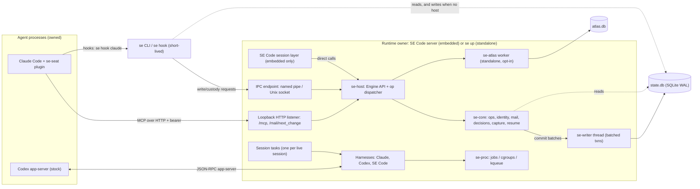

# 00 — Overview and invariants

Status: deep design, reconciled 2026-10-30 against Jimmy's decisions and both whole-design reviews.
The sections describe one system; where they disagreed they were corrected, not ranked. Siblings:
10 types and host API, 20 data model, 30 process ownership, 40 host runtime and harnesses,
50 surface and errors, 60 Atlas, 70/80/90 and 95 (Prime). `docs/OPS.md` is the operation allowlist.

## 1. The product

### 1.1 What it is
StateEngine gives Claude Code and Codex agents a durable identity per project, mail between agents,
decisions a human ratifies, a captured record of every turn, a resume that brings an agent back to
what it was doing, and exact ownership of the processes it starts. It ships as one Rust library that
SE Code's server links, the same library running as one small background process (`se up`) for
people without SE Code, and a thin `se` CLI.

### 1.2 What it is not
Factory machinery stays out: campaigns, reviews, landings, gates, mutation checks, census, remote
compute, brick, routing, Postgres floor administration, mirror and projection repair. The product
and the factory are two repos (Jimmy 2026-10-30): `rust-se` is the shipped product; the existing Node
repo becomes the factory and keeps today's Node engine as its own private library. The factory is not
rewired onto the Rust product in this plan (today 249 of its 391 files import Node product internals
directly); moving the fleet onto Rust is a separate, later project. The product boundary is
mechanical: `OPS.md` lists the operations; CLI help, the MCP tool list and their counts are generated
from the one registry, so no document states a hand-counted number. A crate must not add a public
operation outside OPS.md. Old command names get a static "renamed: use …" refusal, never an
executable alias.

### 1.3 The five journeys (definition of done)
Each runs as a script on clean Windows, macOS and Linux, with Claude and with Codex, inside SE Code
and standalone. Windows and Linux standalone is the first milestone, embedded SE Code the next, and
macOS is qualified in its own campaign before alpha ships; the build does not wait for it. The
scripts are owned by a seat that writes no product code, and they run from a scheduler or a
non-agent shell, never from inside an agent's process tree (owner verbs refuse there).

| ID | Journey | What it forces the design to get right |
| --- | --- | --- |
| J1 | **Install** from a real download; `se --version` in a fresh terminal | Signed self-contained binary, PATH install, no Node, no env vars |
| J2 | **Adopt** an existing repo with `se init`; an agent does a real task | Folder lookup, safe defaults, launch, capture, user files and Git untouched |
| J3 | **Come back** after closing everything; the original conversation resumes with recall | Durable store, conversation resume by default, process re-adoption |
| J4 | **Two agents** hand off by messages; the user sees the handoff and result | Push mail, read marks, attribution, status |
| J5 | **Remove** cleanly | Exact stop, revoke, reverse owned integration edits, keep history and user work |

### 1.4 Hard budgets (pass/fail; the journey runner measures every run)
Everything StateEngine adds, not counting the agent CLIs.

| Budget | Target | Measured so far |
| --- | --- | --- |
| Memory added inside SE Code | **≤ 30 MB** | 1.4 MB (embedding prototype) |
| Startup added to SE Code | **≤ 100 ms**, including the first bound session | p95 75 ms existing store, 96 ms new store (2 of 50 over) |
| Re-adopting agents after handover or restart | **≤ 500 ms**, no lost or doubled input | Proposed by Alpha; unmeasured, a build task |
| Idle cost | **~0 wakeups, < 0.1% CPU** | 0 over 10 min embedded |
| Idle wakeups, exact | **≤ 1/s** across all StateEngine processes with no session, **≤ 2/s** with one; < 0.1% of one core, over 60 s | — |
| Persistent processes | **0 embedded while no agent is live, 1 standalone**; after SE Code exits with live agents, the detached `se up` that took them over is the one standalone process and exits 10 minutes after its last live agent. An auto-started host (from `se launch` or a hook) follows the same 10-minute rule; only an explicit `se up` stays resident (40) | 0 added embedded |
| CLI read command | **p95 < 20 ms** over 30 runs each of `--version`, `status`, `agent list` (was `agents`), `msg inbox`, `msg list`, `decision list` | — |
| Standalone daemon memory | **≤ 25 MB** with one live session | 4–12 MB prototypes |
| CLI write command (B9) | **p95 ≤ 20 ms** (section 80 owns the number) | hooks through host 7.5 ms typical, 9 ms worst; 8 agents 11 ms worst. A later mixed-workload rehearsal measured 37 ms serial and 67 ms with 20 clients; E3 explains the gap before the build |

Line counts come from the one size table in section 95; they are estimates and a review signal,
never a reason to cut quality. No schedule is promised until the early proofs (section 95) settle.

## 2. System shape

### 2.1 Deployment modes

| Mode | Who runs it | Runtime owner | Persistent processes added |
| --- | --- | --- | --- |
| **Embedded** | SE Code's server links `se-host` | SE Code's server process | 0 |
| **Standalone** | `se up` (stays resident), or auto-started by `se launch` or a hook (exits 10 minutes after its last live agent) | the `se up` process | 1 |
| **CLI, host running** | any `se` command | the running host | 0 (CLI exits) |
| **CLI, no host** | read or write commands only | none | 0 |
| **Hook** | Claude runs `se hook claude <event>` | the running host (started if absent) | 0 (hook exits) |

**One runtime owner per OS user.** It holds an exclusive OS file lock on `<run>/runtime.lock` for its
whole life and publishes `<run>/endpoint.json` (IPC address, listener port, host kind
`secode|daemon`, generation, API version). It owns all writes (one batching writer), every owned
process, mail push, the loopback listener and Atlas. SE Code starting under a running daemon asks it
to hand over (drain, release, exit), then takes the lock and re-adopts the agents; SE Code exiting
with live agents hands back to a detached `se up` by default (live handover, Jimmy 2026-10-30: in
before alpha). Participating agents are interrupted to an exact idle before the handover is sealed;
after SE Code exits, the daemon keeps their processes and capture, while SE Code-native input and
mail stay held until SE Code reopens and status says so. After an SE Code crash, whichever owner
starts next adopts them. An ordinary `se down` stops agents on every OS and offers resume. Handover
is section 40; re-adoption is section 30.

**Reads never need the host.** Every reader opens `state.db` directly in WAL mode (inbox at a million
events: 3.5 ms). **Writes go through the host when one runs**, and directly when none runs; both call
the same `se-store` write function, so the paths cannot drift. To make "no host runs" race-free, a
direct writer holds a **shared** lock on `runtime.lock` for the length of its transaction; the host
needs the **exclusive** lock, so it cannot start mid-write, and on start it scans the pending-effects
table, which is the whole to-do list (no file watcher on the database). **Custody** (launch, stop,
wake) always runs in the host; when none runs, the CLI starts it through the private runtime
bootstrap (section 40), never through a public daemon command.

### 2.2 Processes and threads per mode

| Mode | Threads StateEngine adds |
| --- | --- |
| Embedded | No runtime of its own: tasks run on SE Code's tokio runtime via the `Handle` it passes in. One named OS thread `se-writer`, parked on a bounded channel receive (0 wakeups idle). Reads use SE Code's blocking pool (`spawn_blocking`). Windows process exits for every job arrive on one shared IOCP collector per host (one thread blocked on the completion port; no registered-wait thread pool). No Atlas. |
| Standalone | `se up`: tokio `current_thread` on the main thread, `se-writer`, a lazy blocking pool for reads, the Windows IOCP collector (one per host, shared by all jobs), and, only when `atlas.enabled = true` in `config.toml`, the Atlas worker (background priority). |
| CLI and hook | One thread. No async runtime. Blocking SQLite read or one blocking IPC round trip. |

Per live session: one async task (`select!` over its mail watch, process exit, harness events and a
control channel), ~50 KB. No thread, no process, no timer per session.

### 2.3 Components



### 2.4 A CLI write with the host running

```mermaid
sequenceDiagram
  participant U as Terminal
  participant C as se (CLI)
  participant H as Host dispatcher
  participant W as se-writer
  participant DB as state.db
  U->>C: se msg send bob "plan ready"
  C->>C: generated parser; project = -p / SE_PROJECT / registered root containing cwd
  C->>C: try shared lock on runtime.lock: refused (host holds exclusive)
  C->>H: connect IPC, hello{se-types API_VERSION 1.0 framing}, Request{op: message.send, input, idem_key}
  H->>H: peer credentials = this OS user -> Authority::Owner
  H->>W: submit commit batch (bounded queue); the host task awaits its Completion
  W->>DB: BEGIN IMMEDIATE; SAVEPOINT per queued write
  W->>DB: append msg.sent; update inbox projection; insert effect bell=pending
  W->>DB: COMMIT (one commit for the batch)
  W-->>H: Committed{receipt, wakes:[bob]}
  H-->>C: MessageReceipt{committed, delivery: pending}
  H->>H: after commit: bump bob's mail watch
  C-->>U: Sent msg_… to bob. Delivery pending.
```

### 2.5 A CLI write with no host

```mermaid
sequenceDiagram
  participant U as Terminal
  participant C as se (CLI)
  participant DB as state.db
  participant N as Next host start
  U->>C: se decide api-shape "One op type per operation"
  C->>C: try shared lock on runtime.lock: granted (no host; none can start now)
  C->>DB: open; check application_id and user_version (older store: start host, which migrates at startup, then forward)
  C->>DB: same se-core op, same se-store write: BEGIN IMMEDIATE .. append .. projections .. effects pending .. COMMIT
  C->>C: release shared lock
  C-->>U: DecisionReceipt{committed, proposed}
  N->>N: later: take exclusive lock, open store, scan pending effects, deliver
```

### 2.6 A Claude hook capture

```mermaid
sequenceDiagram
  participant CL as Claude Code
  participant K as se hook claude stop
  participant H as Host
  participant T as Claude transcript (.jsonl)
  participant W as se-writer
  CL->>K: spawn, stdin = {session_id, transcript_path, ...}
  K->>K: SE_SESSION handle -> read owner-only pin file
  K->>H: IPC connect (if absent: start se up, wait for endpoint, then connect; host-start vs direct write pending E8)
  K->>H: HookEvent{stop, payload, capability}
  H->>H: verify capability; transcript_path must match the session's capture source
  H->>T: read from stored byte offset, bounded
  H->>W: session.turn events (dedup by provider turn ref) + new offset, one txn
  W-->>H: TurnReceipt{captured n, duplicate m}
  H-->>K: HookResult
  K-->>CL: hook stdout per Claude protocol, exit 0
  Note over K,H: A capture that fails is committed as a named fact (capture-failed + code); exit 0 is never proof of capture
```

### 2.7 A message delivered to a live agent

```mermaid
sequenceDiagram
  participant A as Agent A (Claude)
  participant L as Host listener /mcp
  participant W as se-writer
  participant S as Session task for B
  participant B as Agent B
  A->>L: stateengine_msg_send{to: B, body} + bearer
  L->>L: admit: loopback Host/Origin, bearer -> Authority::Session(A)
  L->>W: append msg.sent, mark unread for B, effect bell=pending
  W-->>L: Committed{wakes:[B]}
  L-->>A: MessageReceipt{committed, delivery: pending}
  L->>S: watch bump (after commit only)
  S->>S: compute delivery debt from durable marks
  alt Claude attended
    S-->>B: plugin long-poll /mail/next_change returns; plugin submits a prompt
  else Claude headless
    S-->>B: stream-json user message on stdin
  else Codex
    S-->>B: app-server turn/start, or steer at the turn boundary
  else SE Code session
    S-->>B: MailEvent into SE Code's own queue (pending, promotion, steer at next tool boundary)
  end
  S->>W: effect bell=offered (offered is not read)
  B->>L: stateengine_msg_read{id}
  L->>W: append mark read by B
  Note over A,B: The read mark, written under B's own authority, is the witness; A sees it in msg_list
```

## 3. Crates

### 3.1 Map and dependency rules

```
se-types  <-  se-store  <-  se-core  <-  se-host  <-  se (binary)
   ^                                       |   |
   +--------------- se-proc <--------------+   |
   +--------------- se-atlas <-----------------+   (feature "atlas")
```

| Crate | Holds | Our deps | I/O allowed | Async | unsafe |
| --- | --- | --- | --- | --- | --- |
| `se-types` | IDs, `SeError` + remedies, `Read<T>`, `Page<T>`/`Window`, receipts, op input/output DTOs, host API types, `API_VERSION` | none | **none** | no | forbid |
| `se-store` | SQLite open/refuse, event log, projections in the same txn, migrations, automatic backup and restore of the newest valid backup, `forget` | se-types | `state.db`, its WAL/SHM, backups | futures only at the writer boundary | forbid |
| `se-core` | Identity and authority checks, sessions, init/adopt/remove records, messages, decisions, capture records, resume, the `ops!` registry and sync executors | se-types, se-store | **only through se-store** | no | forbid |
| `se-proc` | All OS-native calls: process identity, Windows jobs, Linux pidfd + cgroup v2, macOS kqueue, peer credentials on IPC, owner-only ACLs | se-types | OS process/security APIs | no tokio: exposes nonblocking descriptors that se-host registers on its own `AsyncFd` reactor (Linux, macOS) and the one shared per-host IOCP collector (Windows); never creates a runtime | **only here**, every block with `// SAFETY:` |
| `se-atlas` | Code index: walker, tree-sitter, its own db, five queries | se-types | its own `atlas.db`, reads the working tree | incremental updates on a host-scheduled task; the cold index runs in a transient child capped at 64 MB; no tokio in the crate | forbid |
| `se-host` | Engine/generations, writer thread, IPC, listener, MCP, session tasks, harnesses (Claude, Codex, SE Code), integration config edits, transcript reading, custody executors | se-types, se-store, se-core, se-proc, se-atlas (feature) | sockets, pipes, transcripts, integration files, launch files | **yes** (tokio, on a passed-in handle when embedded) | forbid |
| `se` | CLI parsing/rendering, `se up`, `se hook`, `se mcp`, doctor, import, env → config, log subscriber | all | argv, env, stdio, TTY, log file | only `se up`/`se mcp` build a runtime | forbid |

Rules:
- **se-core never sees tokio, sockets, processes, env or the clock directly.** It defines three ports
  the host implements: `Custody` (process actions, implemented with se-proc), `CodeIndex` (Atlas,
  absent when the feature is off) and `Clock`. That keeps the CLI path runtime-free and every op's
  logic in one sync place.
- **Commit, then notify, by type.** A store write returns `Committed { receipt, wakes }`; only se-host
  acts on `wakes`, after `COMMIT` returned. There is no API that notifies before commit.
- **Only se-store and se-atlas link rusqlite** (same pinned version as SE Code, `bundled`). No crate
  issues SQL against the other's database.
- **Only se-host and se do I/O beyond a database**, and only `se` reads env or argv.
- se-atlas does not depend on se-store; `rust-se/README.md` says otherwise and gets corrected.
- Enforced in CI on Windows, macOS and Linux: `cargo metadata` dependency-direction check, unsafe
  location check, `clippy -D warnings`, and a nightly SE Code build against our head.

### 3.2 Feature flags

| Crate | Feature | Default | Meaning |
| --- | --- | --- | --- |
| se-host | `secode` | off | SE Code in-process binding (`HostServices`: interrupt, hold, active-session map) |
| se-host | `listener` | on | Loopback HTTP listener for MCP and plugin mail; embedded needs it so Claude/Codex reach SE Code without a process per agent |
| se-host | `atlas` | off | Wires se-atlas into the dispatcher and resume; tools absent and refusals explicit when off |
| se | `atlas` | on | Standalone binary ships Atlas |
| se | `import` | on | `se import --from-node` |

SE Code links `se-host` with `default-features = false, features = ["secode", "listener"]`; the 30 MB
budget is measured with exactly that set. There is no `postgres` feature: the seam is a trait in
se-store and costs nothing until multiplayer.

## 4. The eight guarantees

| # | Guarantee | Mechanism | Owner | Witness |
| --- | --- | --- | --- | --- |
| G1 | A label cannot change who you are or which project you're in; an unverifiable binding refuses | `Authority` is constructible only by se-host from a verified machine credential + OS user (owner) or a per-call verified session capability. Names resolve to IDs before dispatch. A session's project and actor come only from its capability; no MCP `project_id`/`agent_id`; invalid capability never falls back to owner. Human-only ops need a TTY outside any agent's process tree. | 10, 40, 20 | J4 sender attribution; reviewer tests: foreign actor, revoked capability, conflicting `-p` |
| G2 | History is append-only; corrections supersede; retries are identifiable | Triggers abort UPDATE/DELETE on events; `supersedes` links; `UNIQUE(project, actor, idem_key)` returns `replayed` or `idempotency-key-reused`. Sole exception: `se forget` erases a body and keeps the event. | 20 | Store property tests (crash points, retries); J3 history intact |
| G3 | "Committed" only after the durable append; lagging index or bell stays "pending" | `Receipt` states are types; effects inserted `pending` in the same txn; notify after commit (3.1). Durable means survives a process kill (0 of 100 lost); a power cut can drop the last writes, and the docs say so. | 20, 40 | J4 receipt shows `delivery: pending`, then a read mark; 16 kill trials all-or-none |
| G4 | Unknown, unreadable, absent and zero are different; a refusal names cause and fix | `Read<T>` = Present/Absent/Unreadable/Unknown; store open returns Absent/Unreadable/Present; `SeError` codes with an exhaustive remedy match; exit codes 0/1/2/3/4/64 | 10, 50 | J1 `se status` before init says "not set up" + next step; reviewer test unreadable vs absent |
| G5 | Every read states its window and omissions | `Page<T>` with `Window{from, to, complete, omitted}`; byte budgets cut at UTF-8 boundaries; resume records its cursor; `msg inbox` exits 2 when incomplete | 10, 20 | Property test: pages concatenate to the full read; reviewer partial-inbox test |
| G6 | Process actions recheck the exact owned instance; refuse on pid reuse or unreadable evidence | `ProcessInstance` (pid + start identity + boot id + exe) constructible only in se-proc; Windows host holds job handles, Linux pidfd + BestAvailable containment (a delegated cgroup v2 scope from birth when the systemd user manager grants one, else an explicitly `uncontained` process group named in status and the launch receipt; never a refusal), macOS kqueue; stop rechecks identity and confirms the group empty from outside | 30 | J5 stops only its own agents; J3 stop; reviewer pid-reuse test (a real reuse was refused in the prototype) |
| G7 | Local files and one owner run the whole loop; optional parts cannot weaken 1–6 | One SQLite file, one runtime owner per user. Atlas has its own db and cannot block a write; listener, Atlas and SE Code are optional; nothing needs network or Postgres | 00, 20, 40 | All journeys pass standalone with Atlas off and no network |
| G8 | A writer's own success is not proof of an effect | Effects move to witnessed only on outside evidence: OS reread for stop, digest readback for config edits, the recipient's own read mark for mail, readback for backups and bundles; `history --event` rereads a committed event | 30, 40, 20 | J5 checks integration files restored by reading them; J4 user sees the read mark; journey scripts verify with a separate `se` process |

## 5. Rules every crate follows

### 5.1 Errors and panics
- One error type, `SeError { code, class, detail, retry }` (section 50 owns codes). `Code::remedy()` is
  an exhaustive match: an error without a fix does not compile. No free-form refusal strings.
- `unwrap_used` and `expect_used` are denied workspace-wide (already in `Cargo.toml`); add `panic`,
  `todo`, `unimplemented`, `dbg_macro`, and `print_stdout`/`print_stderr` outside the `se` crate.
- **No panic crosses the SE Code boundary.** Every public `se-host` entry point runs inside
  `catch_unwind`; a caught panic becomes `SeError` class Internal and is logged with its location.
  Only a fault in the writer, the runtime lease, the shared collector, or a lifecycle step (activate,
  drain, close, or a migration after resources started) marks the generation for a generation restart;
  any other caught panic fences only its own route. A session task that panics is restarted at most
  three times in 60 s, then reported failed by name in `status`. This requires `panic = "unwind"`;
  confirm SE Code's release profile (open question 9).
- Mutex poisoning maps to Internal. Sizes read from outside (transcripts, IPC frames) use checked math.

### 5.2 Logging
- `tracing` everywhere. Libraries never install a global subscriber. The `se` binary installs one that
  writes `<logs>/se.log`, rotated by size: 4 MiB, keep 3. Embedded, SE Code routes `stateengine::*`
  targets; se-host offers `log_layer()` that writes the same rotating file so `doctor --bundle` works.
- Level from `SE_LOG` (`error|warn|info|debug|trace` or a target filter), default `info`.
- Info: lifecycle (host, generation, migration, backup, session, process; IDs only). Warn: every
  refusal with its code. Never logged: turn text, message or decision bodies, credentials, env values,
  agent argv (program name + argv sha256 instead). Types enforce it: `Secret` has no `Display` or
  `Serialize` and debug-prints `[redacted]`; `Body` debug-prints length and a hash prefix.

### 5.3 Time and IDs
- Order comes from the store's `seq`, never from clocks or IDs. Wall clock only for `recorded_at`
  (UTC microseconds, via the `Clock` port) and display; durations and timeouts use `Instant`.
  `occurred_at` from a source (transcript time) is kept separately and never orders anything.
- New IDs are **UUIDv7**, typed per kind (`ProjectId`, `AgentId`, `SessionId`, `MessageId`,
  `DecisionId`, `EventId`, `LaunchId`, `ObservationId`), text form = kind prefix + UUID, codec owned by
  section 10. Imported legacy IDs keep their text. Cursors are opaque. No rowid leaves se-store.

### 5.4 Paths

| | Windows | Linux | macOS |
| --- | --- | --- | --- |
| State (`state.db`, backups, pins, launch files, `atlas.db`) | `%LOCALAPPDATA%\StateEngine` | `$XDG_STATE_HOME/stateengine` (`~/.local/state/stateengine`) | `~/Library/Application Support/StateEngine` |
| Config `config.toml` | state dir (`$SE_HOME`) | state dir (`$SE_HOME`) | state dir (`$SE_HOME`) |
| Logs | `<state>\logs` | `<state>/logs` | `~/Library/Logs/StateEngine` |
| Run (`runtime.lock`, `endpoint.json`) | `<state>\run`; pipe `\\.\pipe\stateengine-<user-sid-hash>` | `$XDG_RUNTIME_DIR/stateengine`, else `<state>/run` (0700) | `<state>/run`; socket falls back to `$TMPDIR/se-<uid>/` when the path exceeds 104 bytes |
| `se` on PATH | `%LOCALAPPDATA%\StateEngine\bin\se.exe` | `~/.local/bin/se` | `~/.local/bin/se` |

`SE_HOME` puts all of it under one directory. Never inside a repository. The store refuses a network
or cloud-synced home with the fix "set SE_HOME to a local folder". Secret-bearing files are owner-only
and the ACL is read back (se-proc).

### 5.5 Configuration
Precedence: **flag > `SE_*` env > `config.toml` > built-in default.** There is no project settings layer.
Never from cwd, the repo or an engine root, except project selection by exact lookup of a registered
root. Only the `se` binary reads env; embedded, SE Code passes `EngineConfig` and the library reads
nothing ambient. Six environment variables:

| Var | Meaning |
| --- | --- |
| `SE_HOME` | Product state home (all paths in 5.4) |
| `SE_PROJECT` | Owner project selection, after `-p` |
| `SE_SESSION` | Session handle set in a launched agent's env; the secret stays in an owner-only pin file |
| `SE_LOG` | Log level or filter |
| `SE_CONFIG` | Alternate `config.toml` path |
| `NO_COLOR` | Plain output |

`STATEENGINE_*` and `SECODE_STATEENGINE_*` are never read; `status` and `doctor` report any that are
set. Launched agents get a constructed environment with all `SE_*`/`STATEENGINE_*` stripped and only
`SE_SESSION` (and `SE_HOME` if set) added. Fleet tuning knobs become constants. Enforced with
clippy `disallowed-methods` on `std::env::var*` outside `se::config`.

### 5.6 Concurrency
- **No transaction across an await, and no host thread waits on the writer.** se-core is synchronous
  and never waits on a commit: a write returns `OpStep::Commit { batch, then }`, a typed continuation
  (not a closure holding a transaction). The host submits the batch to the writer, awaits the
  `Completion` (`CommitWait`) on its async task, then runs `then` with the `CommitReceipt`. The
  hostless CLI's direct route gets the same receipt synchronously from `DirectStore::append`. se-store exposes futures only at the writer boundary; `Tx` is `!Send` and never
  leaves the writer thread.
- One writer per store: the `se-writer` thread drains a bounded queue, groups what is waiting into one
  `BEGIN IMMEDIATE … COMMIT`, one `SAVEPOINT` per request so one failure rolls back only itself (20).
  No OS call, network call or harness call inside a transaction.
- SQLite: WAL, `synchronous=NORMAL`, 2 MB cache per connection, `busy_timeout` with refusal
  `store-busy` and a fix when exceeded.
- **Only bounded channels.** `unbounded_channel` and `std::sync::mpsc::channel` are disallowed by
  clippy config. Queue full: host callers wait; IPC callers get `retry`. Mail fan-out uses `watch`
  (latest value, no queue); subscriptions are bounded and overflow yields `Lagged{resume_from}`,
  never a silent drop.
- No blocking in async code (use `se-writer` or `spawn_blocking`). No timers without a live session, except the auto-started host's 10-minute exit timer (40).

### 5.7 Cancellation
- Each generation owns a `CancellationToken`; sessions and requests take child tokens. Generation
  drain: stop admissions (typed `retry`), cancel, join with a deadline, flush the writer, reopen.
- A write handed to `se-writer` finishes regardless of caller cancellation; a dropped caller finds the
  outcome by its idempotency key (G2).
- A custody action cancelled after spawn never orphans: the process is already recorded and owned,
  and the receipt says what happened. CLI Ctrl-C on a custody op prints how to check it with
  `se status`.

### 5.8 Versioning
- One workspace version for all crates, `0.x` through alpha.
- Host API: SE Code links StateEngine statically, so the API is one exact version checked at build
  and at `Engine::open` (section 10); there is no minor-range negotiation. No dynamic ABI and no hot
  reload. Library crates use caret dependency ranges, never exact pins, so they never force SE Code's
  lock (SE Code: tokio "1", rusqlite "0.40" bundled, axum "=0.8.9" in secode-api).
- Outputs: every JSON payload carries `"schema": "se.<family>/vN"`. The SE Code session-context
  adapter keeps its frozen format; no N-1 encoders are built until an N-1 exists.
- Store: `PRAGMA application_id` (constant, refuses foreign files) and `user_version`. Only the host
  migrates, at its own startup, as the sole owner: it takes a verified pre-migration backup, applies
  supported additive migrations, then serves. There is no manual migration step. A too-new or
  unsupported store refuses with a remedy; an older binary refuses to write a newer store; if an older
  host is still running, the new version refuses and says to run `se down` first.
- The Claude plugin protocol and Codex app-server protocol versions are checked at launch; a too-old
  CLI refuses with the upgrade command.

## 6. Glossary (words a stranger sees)
- **Project** — a repository you registered with `se init`. `se` finds it from the folder you are in.
- **Agent** — a named, durable worker in a project (for example "planner"), backed by Claude Code or
  Codex. It keeps its name, history and conversation across restarts.
- **Provider** — Claude Code or Codex. **Conversation** — the provider's own chat thread; `se launch`
  reopens it, `--new` starts another.
- **Session** — one running instance of an agent, from launch to stop.
- **Host** — the part of StateEngine that runs agents and delivers mail: inside SE Code, or the
  `se up` background process.
- **Owner** — you, the human at the terminal. Some actions (ratify, remove, forget) only you can do.
- **Message** — a note one agent or you sends another. **Inbox** — your unread messages.
  **Read / dismissed** — what the recipient did with it.
- **Decision** — a statement an agent proposes and you ratify, reject, retract or replace.
- **Turn** — one prompt and reply. **Capture** — saving turns from the provider's transcript.
- **Resume** — what an agent gets when it comes back: who it is, what it was doing, unread mail,
  decisions, recent turns. **Working state** — the agent's own note of its current task.
- **Receipt** — the answer to an action: committed, already done, refused (with the fix) or pending.
- **Pending** — saved, but the follow-up (like waking the recipient) is not confirmed yet.
  **Witness / confirmed** — checked from outside, not just reported by whatever did it.
- **Window** — which part of a list you saw and whether anything was left out.
- **Launch / stop / wake** — start an agent, stop exactly that agent, nudge a running agent.
- **Profile** — saved permission and model settings. Full bypass needs a profile you name.
- **Adopt** — register an existing repo in place, without changing your files or Git history.
- **Remove** — stop a project's agents and undo StateEngine's setup; history is kept. **Forget** —
  erase a captured secret.
- **Doctor** — checks your install and explains fixes; `--bundle` makes a redacted support zip.
- **Atlas** — optional code map: find, refs, impact, changes, outline.
- Words that never appear in product output: seat, floor, lane, Prime, landing, gate, organ.

## 7. Decisions

### 7.1 Settled

| Decision | Source |
| --- | --- |
| Rebuild the product in Rust; plan before building | Ledger `rust-redesign-planned-before-rebuild-2026-10-30` |
| Done = five journeys on three OSes | Jimmy 2026-10-29 (`jimmy-2026-10-29-done-is-five-journeys`) |
| Product separated from factory; authors write no tests (reviewers add black-box and 6–8 property tests) | Jimmy 2026-10-29; plan |
| Own repo at `E:\stateengine\rust-se`; journeys in a separate repo | Jimmy 2026-10-30 (plan) |
| Project found from the folder you are in; any existing repo can be adopted (supersedes KERNEL's "never inferred from cwd" for owner CLI; never creates) | Jimmy 2026-10-30 (plan); OPS.md |
| `se launch` resumes the conversation for Claude and Codex; `--new` starts fresh | Jimmy 2026-10-30 (plan) |
| Alpha keeps everything users need, including import, windowed launch, handover; only Postgres multiplayer waits | Jimmy 2026-10-30 (plan) |
| Closed source; public SE Code build stubs StateEngine out of its dependency graph | Jimmy 2026-10-30, 2026-10-08 |
| Embedded in SE Code, no sidecar | Measured: 1.4 MB, +114 KB, 0 threads, 75/96 ms p95 |
| WAL + `synchronous=NORMAL` | Measured: FULL 41–49 ms/commit; NORMAL 7.5/9 ms, 8 agents 11 ms, 0/100 lost on kill |
| Host owns writes through a batching writer; direct write only with no host (resolves the 01/02 conflict) | Measured: 20-agent burst 22/77 ms vs 456–806 ms with lock failures direct |
| No file watcher on the database | Plan; measured zero idle CPU |
| Hooks hand writes to the host | Measured: 52–76 ms direct vs 3 ms bare start |
| Windows: host holds job handles; host death stops the tree; relaunch resumes | Measured (5p), corrected named-job assumption |
| Linux: BestAvailable containment. On the first agent launch the host (embedded in SE Code or `se up`) lazily asks the systemd user manager for one delegated user scope for agents only (`systemd-run --user` transient unit, SE Code's existing pattern) and places agents there in cgroup v2 from birth. With no user manager or delegation (containers, WSL without systemd, minimal hosts) agents run in an explicitly `uncontained` process group: launch succeeds, and status and the launch receipt name `containment` and the probe cause. Never a launch refusal. In that mode a stop reports the process-group bound honestly: a tool that calls setsid or double-forks can escape the group, and the stop receipt says so rather than claiming every descendant is gone | Agreed with Alpha, adopted in 30; measured: 28/28 trees, 15 ms readiness, 2.7 MB (contained path) |
| Claude via launch flags, no config writes; hooks call `se`; mail through the plugin's small JS | Plan; measured (Vera) |
| Stock Codex over app-server; never bundle a fork | Jimmy 2026-10-23/24; measured with 0.166 |
| One op definition generates CLI and MCP; OPS.md is the allowlist; old names refuse with a hint | Plan; OPS.md `f8a2e59` |
| Atlas: own db, code only; compiled only into the standalone `se`, disabled by default and enabled by `atlas.enabled = true` in `config.toml`; in embedded SE Code that setting returns feature-unavailable; cold index in a transient capped child; built after the five journeys and live handover pass and never holds a milestone | Jimmy 2026-10-30; measured: 1.36M lines in 165 s, 20 MB peak, 11 MB settled, 67 ms save-to-search |
| No hash chain over events or decisions; immutable typed decision transitions with expected revisions; no rollback writer into Node formats | Reconciliation 2026-10-30; OPS.md |
| The host migrates automatically at startup as sole owner, after a verified pre-migration backup; no manual migration step; backups at start-of-day and clean shutdown, two kept, restore of the newest valid backup | Reconciliation 2026-10-30; Jimmy 09-02 (no manual steps) and 10-21 (refuse mixed old/new) |
| Live handover is in before alpha; agents are interrupted to exact idle first; SE Code-native routes stay held while SE Code is gone | Jimmy 2026-10-30 |
| `forget` is in alpha, built after the five journeys | Jimmy 2026-10-30 |
| Human-only actions are mistake and drift guards, not proof against a determined agent on the user's own account, and say so | Jimmy 2026-10-30 |
| Product and factory are separate repos; the factory keeps the Node engine | Jimmy 2026-10-30 |
| Every public mutation carries one request identity reused across uncertain retries (CLI prints it, MCP requires it) | Reconciliation 2026-10-30 |
| Codex minimum 0.152 (helper Authorization and credential refresh), one constant | Measured 2026-10-30 |
| Writes: NORMAL can lose several recent ordinary commits on power loss or OS crash; decisions, credentials and owner records commit FULL | Reconciliation 2026-10-30 |
| `se forget` really erases, and says what it cannot reach | Plan |
| Loopback listener on a per-user port chosen at init; human-only actions need a TTY outside agent trees | Plan |
| No telemetry; downloads from stateengine.ai | Plan defaults |
| Toolchain 1.97.1, edition 2024, `unsafe` only in se-proc, unwrap/expect denied | Workspace `0ca97ba` |
| SE Code requirements: takeover = interrupt + hold + absent from active map; one mail queue (SE Code's); crash adoption; job breakaway; async rules; vendored source for offline builds; Rust embedding after SE Code 0.1 | Alpha's review (plan) |

### 7.2 Open

Each open item is settled by an early proof in section 95, not by argument.
1. **CLI write budget (B9 ≤ 20 ms)** — a mixed-workload rehearsal measured 37 ms serial and 67 ms
   with 20 clients. Batching and queueing are fast; the time is in commit, with about one group in
   eleven paying ~36 ms. The automatic WAL checkpoint running inside the commit is a hypothesis, not
   a proven cause. E3 keeps the failed baseline, decomposes commit time first, may compare an
   off-path checkpoint variant, and adopts a change only through one reviewed checkpoint policy
   reflected in 20, 40, 80 and 95. No B9 fix is claimed until native host measurements pass.
2. **First-bind cost (B2 ≤ 100 ms embedded)** — several FULL commits now precede the first answer
   (runtime owner, session activation, new-schema publication; embedded binds mint no credentials).
   E2 measures it on Windows with Defender on a new and an existing store.
3. **Re-adoption ≤ 500 ms (B8)** — native pipe transfer and real-provider handover pass on Windows and
   Linux (spikes, 2026-10-30); store lease, capture, queue and timing are measured in the build.
4. **Hook with no host** — cold start from a hook on Windows with Defender (E8) decides host-start
   versus a direct write under the shared lock (40).
5. **Signing** — Trusted Signing (suggested) or a certificate; Apple Developer ID enrollment (Jimmy).
6. **Mac hardware** for the compatibility campaign (Jimmy's borrowed Mac).
